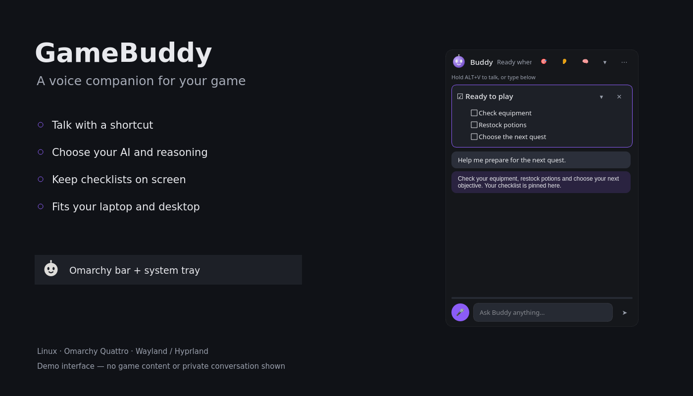
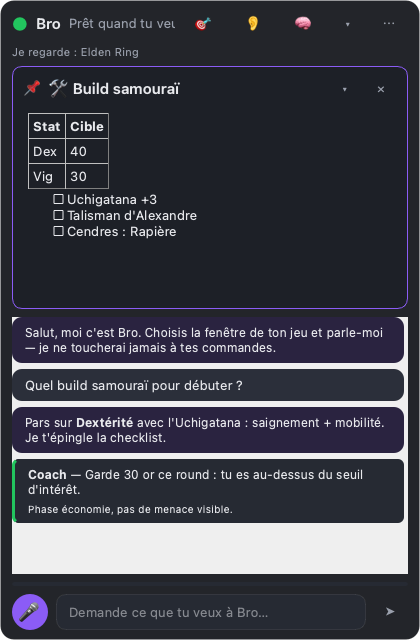

# GameBuddy

<p align="center"><strong>Compagnon de jeu IA, piloté à la voix, pour Linux</strong><br>
Reste dans ton jeu, parle à Buddy. Un compagnon IA vocal pour Wayland, Hyprland et Omarchy.</p>

<p align="center"><a href="README.md">🇬🇧 English version</a></p>

<p align="center"></p>

GameBuddy, c'est **Buddy** : un assistant IA qui vit dans un petit widget à côté de ton jeu.
Tu maintiens une touche pour parler, ou tu choisis un appui pour démarrer et un second pour arrêter ; Buddy voit la fenêtre de jeu que tu as choisie,
cherche sur le web, répond dans ta langue, garde tes builds et checklists épinglés à
l'écran, et se souvient des détails utiles d'une session à l'autre. Il **conseille
seulement** : il n'injecte jamais d'entrées, ne lit pas la mémoire du jeu et ne joue pas à ta place.

Tout tourne en local, sauf les appels IA que tu configures (ta propre clé, ou un modèle
local via Ollama).

## Ce qu'on voit en jeu

Buddy s’adapte à ton écran : une **petite tête animée** sur laptop, ou un **orbe avec du texte** quand la place le permet. Il
cligne des yeux au repos, pulse quand il écoute, fait tourner des points quand il réfléchit et bouge
la bouche quand il parle. Les clics hors de l'orbe vont au jeu. Un clic sur le visage (ou une
checklist qu'il épingle) ouvre le panneau complet : contenu épinglé, conversation, saisie texte.
`mode = "panel"` dans `[ui]` démarre directement avec le panneau.

<p align="center"></p>

<p align="center"> &nbsp; </p>

Ces captures montrent l’interface actuelle avec du texte de démonstration. La petite tête et l’orbe sont présentés à leur taille logique.

## Plugin Omarchy Quattro

Le dépôt fournit un **widget de barre natif** qui pilote le moteur Python séparé.
L’ajout du plugin ne lance pas l’installeur et n’installe aucun paquet en arrière-plan.

```bash
omarchy plugin add https://github.com/Roddygithub/gamebuddy.git --enable
cd ~/.config/omarchy/plugins/io.github.roddygithub.gamebuddy
./install.sh                 # à lire avant : sudo uniquement pour les paquets système manquants
gamebuddy doctor
gamebuddy                    # assistant de configuration au premier lancement
```

Clic gauche sur la tête : démarrer/afficher/masquer Buddy. Clic droit : réglages IA.
Clic du milieu : choisir le jeu. L’icône reprend les couleurs de la barre, s’atténue
quand le moteur est arrêté et change de couleur pendant l’écoute. Le systray de
l’application reste indépendant ; tu peux masquer son icône si elle fait doublon.

L’installeur crée un virtualenv, une commande, une entrée de bureau, des unités
systemd utilisateur et les raccourcis du compositeur. Il sauvegarde les fichiers
du compositeur qu’il modifie. Le timer de vérification quotidienne est activé
(notification seulement par défaut), mais pas le démarrage automatique de Buddy.
Codex, les comptes API, Ollama, voxtype ou Piper restent à configurer séparément
selon le fournisseur choisi. Python ≥3.11, Qt/PySide6, PortAudio et les dépendances
Python du projet sont nécessaires au moteur ; la capture Hyprland utilise grim.

Suppression complète (garde la configuration et la base de conversations) :

```bash
cd ~/.config/omarchy/plugins/io.github.roddygithub.gamebuddy
./install.sh uninstall
omarchy plugin remove io.github.roddygithub.gamebuddy --yes
```

Supprimer uniquement le plugin retire son widget de barre ; l’application et ses
services restent installés. Les paquets système ne sont pas supprimés automatiquement.
Détails : [validation et publication du plugin](docs/OMARCHY-PLUGIN.md).

## Utilisation au quotidien

### Réutiliser Superwhisper

Si Superwhisper est installé, choisis `superwhisper` dans **Réglages → Voice → Speech to text**
(ou `stt = "superwhisper"` dans `[speech]`). GameBuddy lui transmet son enregistrement
et reprend le texte de la session correspondante, sans le coller dans le jeu.
Le mode de traitement, les modèles, la langue et le vocabulaire suivent les réglages de
Superwhisper ; le champ **STT model** de GameBuddy est ignoré. Le micro et les raccourcis
restent ceux de GameBuddy. Les transcriptions suivent aussi la politique d’historique de
Superwhisper. Le fournisseur IA et la voix de réponse restent configurés dans GameBuddy.

### Taille adaptative de Buddy

Par défaut, `compact_orb = "auto"` dans `[ui]` affiche une petite tête de 64 × 64
sur les écrans dont la surface utile ne dépasse pas 1280 pixels de large ou
800 pixels de haut. Ces dimensions sont en pixels logiques : la mise à l’échelle
HiDPI du bureau est donc prise en compte. Sur les écrans plus grands, l’orbe
avec texte mesure 260 × 96. Le panneau reste limité à la surface utile et la
présentation se réadapte lors d’un changement d’écran ou de résolution.

`compact_orb = true` force la petite tête ; `false` garde l’orbe avec texte.
L’icône de Buddy dans le systray est fournie comme icône symbolique monochrome :
les bureaux compatibles, dont Omarchy, l’adaptent à la couleur de leur barre.

### Choisir l’IA depuis le systray

Clic droit sur la tête de Buddy → **IA / raisonnement** : le choix actif est
indiqué en haut. Avec Codex, le sous-menu **Modèle** reprend le catalogue local
du CLI (s’il est disponible), et **Raisonnement** propose les niveaux déclarés
pour le modèle sélectionné. Les changements sont sauvegardés pour les prochains
échanges ; le menu est désactivé pendant une réponse. **Autre IA / modèle…** ouvre
l’onglet IA des réglages, avec fournisseur, modèle personnalisé et accès API.
Le raisonnement est proposé pour Codex et Anthropic ; les autres adaptateurs
n’envoient pas ce paramètre.

### Micro, raccourcis et délai de réponse

Dans **Réglages → General**, clique dans le champ du raccourci puis presse la
combinaison souhaitée. **Maintenir pour parler** enregistre jusqu’au relâchement ;
**Appuyer pour démarrer / arrêter** commence au premier appui et envoie au second.
Le raccourci d’affichage est configurable aussi. Les fragments Hyprland générés
et gérés par GameBuddy sont actualisés automatiquement, avec détection des
conflits et retour en arrière si la configuration est invalide. Sur les autres
bureaux, actualise aussi les raccourcis globaux du bureau. `gamebuddy hyprland-config`
et `sway-config` tiennent compte du mode choisi.

Le délai cumule transcription, capture, appels IA/recherche et synthèse vocale.
Les modèles Whisper déjà téléchargés sont préchargés en arrière-plan, sans
écouter le micro ni accéder au réseau. Dans l’onglet Voice, `tiny` réduit le coût
CPU au prix d’une précision potentiellement moindre ; `base` reste un compromis.
`gamebuddy status` expose les dernières durées de transcription et de réponse IA.

## Fonctionnalités

- **Voix d'abord** — maintiens `Alt+V` (configurable) pour parler, ou active l'écoute mains libres. Le clavier marche aussi.
- **Il voit ton jeu** — Buddy capture la fenêtre choisie (Hyprland, sway, wlroots générique, X11) et masque son propre widget dans l'image.
- **Recherche et connaissances** — recherche web + lecture de pages pour patch notes, méta, builds ; connaissances du modèle pour la stratégie.
- **Conversation continue** — le fil survit aux redémarrages ; la mémoire longue durée est une base SQLite locale.
- **Contenu épinglé** — builds, checklists, tableaux, liens ou vidéos restent visibles jusqu'à remplacement.
- **Réponses parlées** — TTS OpenAI, piper ou espeak-ng ; transcription OpenAI, [voxtype](https://github.com/peteonrails/voxtype) (l'outil de dictée d'Omarchy, builds GPU), faster-whisper (hors ligne) ou whisper.cpp.
- **Mode coach (optionnel, expérimental)** — observation périodique avec une porte de validation prudente : silence tant qu'une fenêtre de décision lente n'est pas clairement visible. Voir [docs/COACH-MODE.md](docs/COACH-MODE.md).
- **Multilingue** — interface en français, anglais, allemand, espagnol, italien, portugais (BR/PT) ; Buddy répond dans la langue que tu parles.
- **Fournisseurs** — un abonnement ChatGPT Plus/Pro (via le Codex CLI, sans clé API), Anthropic Claude, OpenAI, Ollama, ou tout endpoint compatible OpenAI.
- **Scriptable** — IPC par socket Unix et CLI (`gamebuddy ptt start`, `gamebuddy ask "…"`, `gamebuddy toggle`) : c'est ainsi que les raccourcis Hyprland et le widget de barre Omarchy le pilotent.

## Avec un abonnement ChatGPT Plus / Pro (sans clé API)

GameBuddy fonctionne avec un abonnement ChatGPT via le **Codex CLI officiel d'OpenAI**, qui se
connecte avec ton compte ChatGPT et décompte l'usage sur les limites de l'abonnement :

```bash
npm install -g @openai/codex     # ou le paquet de ta distribution
codex login                      # « Se connecter avec ChatGPT » dans le navigateur, une seule fois
```

Choisis ensuite le fournisseur `codex` dans l'assistant de démarrage, ou mets
`provider = "codex"` dans `config.toml`. Chaque question devient une exécution `codex exec`
(prompt + capture, bac à sable lecture seule, aucune session écrite) ; épinglage, mémoire et
recherche web passent par une enveloppe « actions » que GameBuddy exécute. Contreparties :
quelques secondes de latence en plus, pas de streaming, et pas d'API vocale — la voix bascule
sur des moteurs locaux (voxtype si l'outil de dictée d'Omarchy est installé, sinon faster-whisper, pour la
transcription ; piper ou espeak-ng pour la
synthèse). `./install.sh` installe faster-whisper et espeak-ng ; voxtype et Piper sont optionnels. `gamebuddy doctor` indique si Codex est
installé et connecté.

## Démarrage rapide (Arch Linux / Omarchy)

```bash
git clone https://github.com/Roddygithub/gamebuddy.git
cd gamebuddy
./install.sh
```

L'installeur ajoute les outils système via pacman (`grim`, `python`, `portaudio`, `espeak-ng`…),
crée un virtualenv isolé dans `~/.local/share/gamebuddy/venv`, lie la commande `gamebuddy` dans
`~/.local/bin`, ajoute les règles et raccourcis Hyprland dans `~/.config/hypr/`, et installe
une entrée de bureau plus un service `systemd --user` (non activé par défaut).

Ensuite :

```bash
codex login                           # ChatGPT Plus/Pro — ou export ANTHROPIC_API_KEY / OPENAI_API_KEY
gamebuddy                               # le premier lancement ouvre l'assistant de configuration
```

Widget de barre Omarchy (une icône qui affiche/masque Buddy) :

```bash
omarchy plugin add https://github.com/Roddygithub/gamebuddy.git --enable
omarchy bar put io.github.roddygithub.gamebuddy --after omarchy.clock
```

### Installation manuelle (toute distribution)

```bash
pipx install 'git+https://github.com/Roddygithub/gamebuddy.git'    # ou : uv tool install …
gamebuddy hyprland-config >> ~/.config/hypr/hyprland.conf          # utilisateurs Hyprland
gamebuddy doctor                                                    # vérifie outils, micro, clés
gamebuddy
```

Paquets système : `grim` (captures Wayland), `portaudio` (micro), en option `espeak-ng` ou
`piper` pour la voix hors ligne, `wmctrl` + ImageMagick sous X11.

## Configuration

`~/.config/gamebuddy/config.toml` (créé par `gamebuddy config init`, modifiable dans les Réglages ou
avec `gamebuddy config edit`). Les clés principales :

```toml
[general]
language = "auto"          # fr, en, de, es, it, pt-BR, pt-PT
assistant_name = "Buddy"
personality = "coach"      # coach | friendly | concise

[ui]
compact_orb = "auto"      # auto | true | false

[hotkeys]
mode = "hold"             # hold | toggle
push_to_talk = "ALT, V"    # syntaxe des binds Hyprland
toggle_widget = "ALT, B"

[llm]
provider = "codex"         # codex (ChatGPT Plus) | anthropic | openai | ollama | openai_compatible
model = ""                 # défaut du fournisseur ; choix dans le systray ou les réglages IA
effort = "low"             # anthropic / codex : réponses rapides et peu coûteuses en jeu

[speech]
stt = "voxtype"            # openai | voxtype | faster_whisper | whispercpp | none
tts = "espeak"             # openai | piper | espeak | none

[coach]
enabled = false
model = ""                 # vide : modèle par défaut du fournisseur
```

`voxtype` réutilise la pile de dictée d'Omarchy (*Install > AI > Dictation*, ou `yay -S voxtype`) :
mêmes modèles Whisper que faster-whisper, mais avec ses builds GPU Vulkan/ROCm et le modèle déjà
téléchargé. Laisser `stt_model` vide pour utiliser la config de voxtype.

Configuration 100 % locale : `provider = "ollama"`, `model = "qwen3-vl"` (vision + appels d'outils : recherche web et épinglage continuent de marcher ; un modèle sans outils répond simplement sans),
`stt = "faster_whisper"` (`pip install 'gamebuddy[local]'`), `tts = "piper"`. La recherche web est faite par GameBuddy lui-même (DuckDuckGo + lecture de page), donc elle marche avec n'importe quel fournisseur.

## Bureaux et distributions

| Session | Vision du jeu | Règles d'overlay / push-to-talk |
|---|---|---|
| Hyprland | fenêtre choisie (`hyprctl` + `grim`) | `gamebuddy hyprland-config` (écrit par l'installeur) |
| sway | fenêtre choisie (`swaymsg` + `grim`) | `gamebuddy sway-config` (écrit par l'installeur) |
| autres wlroots (river, niri, labwc…) | écran entier (`grim`) | lier `gamebuddy ptt start/stop` et `gamebuddy toggle` dans le compositeur |
| GNOME / KDE Wayland | écran entier (`spectacle`, `gnome-screenshot` ou le portail xdg) | raccourcis personnalisés vers les mêmes commandes ; `hotkeys.mode = "toggle"` si le bureau ne gère pas le relâchement |
| X11 | fenêtre choisie (`wmctrl` + ImageMagick) | écouteur global intégré (`pip install 'gamebuddy[x11]'`, `hotkeys.x11_listener = true`) |

`install.sh` installe les paquets système via pacman, apt, dnf ou zypper ; le reste passe par pip.
Omarchy n'apporte rien d'obligatoire : ses couleurs de thème et sa pile de dictée voxtype sont reprises si présentes.

## Mises à jour

```bash
gamebuddy update            # récupère la dernière release et réinstalle (redémarre le widget)
gamebuddy update --check    # juste vérifier
```

L'installeur active un timer utilisateur quotidien (`gamebuddy-update.timer`). Avec
`auto_update = "notify"` (défaut), le widget affiche une bulle et une entrée dans le menu de la
barre quand une nouvelle version existe ; `auto_update = "auto"` dans `[general]` (ou Réglages →
Updates) laisse le timer l'installer tout seul, `"off"` ne vérifie jamais. Les releases sont de
simples tags git publiés par GitHub Actions : pas de binaire, toujours le code source lisible.

## Hyprland

`gamebuddy hyprland-config` imprime règles et raccourcis adaptés à ta version de Hyprland
(`windowrulev2` historique, syntaxe `match:` ≥ 0.53, Lua ≥ 0.55). Le widget est une
fenêtre flottante épinglée : visible sur tous les espaces de travail et au-dessus des jeux
en fenêtré / plein écran sans bordure. La prise en charge du plein écran exclusif dépend du compositeur et du jeu.

## CLI

| Commande | Effet |
|---|---|
| `gamebuddy` | lance le widget (instance unique) |
| `gamebuddy ptt start\|stop\|toggle` | push-to-talk |
| `gamebuddy ask "quel objet ?"` | pose une question depuis un script |
| `gamebuddy toggle` / `show` / `hide` | visibilité du widget |
| `gamebuddy listen on\|off` | écoute mains libres |
| `gamebuddy coach on\|off` | mode coach |
| `gamebuddy select-window [id]` | choisit la fenêtre du jeu (`gamebuddy windows` liste les ids) |
| `gamebuddy doctor` | vérifie outils, micro, clés, version Hyprland |
| `gamebuddy memory list\|forget` | consulte ou efface la mémoire longue durée |

## Vie privée

- Les captures ne sont prises que quand tu poses une question (ou en mode coach) et ne partent que vers le fournisseur que tu as choisi. Seuls le texte de la conversation et tes notes sont écrits sur disque (`~/.local/share/gamebuddy/gamebuddy.db`). Le dossier de données est réservé à ton compte (mode `700`), ainsi que la base et les fichiers SQLite associés (mode `600`).
- Le chargement des pages web est limité aux adresses IP publiques et chaque redirection est vérifiée. eSpeak reçoit les réponses via l'entrée standard, pas dans les arguments visibles du processus.
- Avec le fournisseur Codex, Buddy conserve la session ChatGPT mais ignore le reste de la configuration Codex de l'utilisateur et désactive le shell, la lecture d'images locales, la recherche web et les connecteurs. Seule la capture du jeu choisie est jointe.
- Les clés API restent dans `config.toml` (mode 600) ou dans ton environnement.
- Pas de télémétrie, pas de compte, pas de serveur à nous.

## État du projet

Version actuelle : **0.3.1**. La validation de structure et de compatibilité Quattro du marketplace Omarchy est passée. Un mainteneur a approuvé la révision `b73930d` après revue des capacités. Le moteur nécessite une installation manuelle : [suivre la demande et la publication](https://github.com/omacom/omarchy-plugin-marketplace/issues/13577).

La capture par région peut montrer une fenêtre qui recouvre le jeu. Le mode coach reste expérimental. Le son et les compositeurs réels nécessitent une session de bureau pour être vérifiés.

## Licence

MIT — voir [LICENSE](LICENSE). Projet communautaire indépendant, sans affiliation avec un éditeur de jeux ou un fournisseur d'IA.
