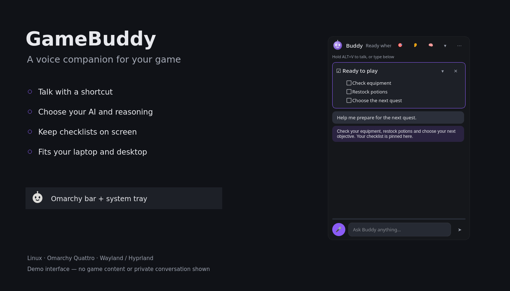
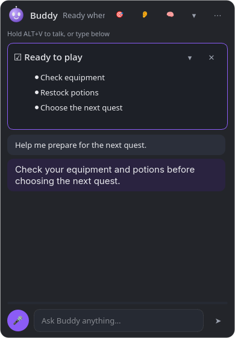

# GameBuddy

<p align="center"><strong>Voice-first AI gaming companion for Linux</strong><br>
Stay in your game, talk to Buddy. A voice-first AI companion widget for Wayland, Hyprland and Omarchy.</p>

<p align="center">
  <a href="https://github.com/Roddygithub/gamebuddy/actions/workflows/ci.yml"></a>
  <a href="LICENSE"></a>
  <a href="README.fr.md">🇫🇷 Version française</a>
</p>

<p align="center"></p>

GameBuddy is an AI companion named **Buddy** that lives in one small widget next to your game.
Hold a key to talk, or choose press-to-start/press-again-to-stop; Buddy can see the game window you selected, search the web,
answer in your language, keep builds and checklists pinned on screen, and remember
useful details between sessions. It **advises only**: it never injects input,
reads game memory, or plays for you.

Everything runs locally except the AI calls you configure (bring your own key, or a
local model through Ollama).

## What you see in game

Buddy adapts to your screen: a **small animated head** on a laptop, or an **orb with a caption** when there is more room. He blinks
while idle, pulses while listening, spins dots while thinking and moves his mouth while speaking.
Clicks outside the orb go to the game. Click the face (or let him pin a checklist) and the full
panel opens: pinned content, transcript, text input. Set `mode = "panel"` under `[ui]` to start
with the panel instead.

<p align="center"></p>

<p align="center"> &nbsp; </p>

Screenshots show the current interface with demo text. The compact head and captioned orb are shown at their logical sizes.

## Omarchy Quattro plugin

GameBuddy includes a native Omarchy **bar-widget** plus a separate Python voice/AI
engine. Adding the plugin clones the code; it **does not install Python packages,
run the installer or start a second Quickshell process**.

```bash
omarchy plugin add https://github.com/Roddygithub/gamebuddy.git --enable
cd ~/.config/omarchy/plugins/io.github.roddygithub.gamebuddy
# Review this script before running it. It may ask sudo for missing system packages.
./install.sh
gamebuddy doctor
gamebuddy
```

Configure a provider in the first-run wizard (a signed-in Codex CLI, your own API
key, or a local Ollama server). The bar head follows the shell colors; left-click
starts/shows/hides Buddy, right-click opens AI settings, and middle-click selects
the game window. The icon dims when the engine is stopped and uses the bar accent
while listening. Its tooltip explains when the engine is missing. The app's
independent tray icon remains available; use Omarchy's tray management to hide it
if you prefer the bar widget alone.

```bash
omarchy bar move io.github.roddygithub.gamebuddy --section right
omarchy plugin disable io.github.roddygithub.gamebuddy
omarchy plugin enable io.github.roddygithub.gamebuddy
```

### Dependencies and setup effects

The bar requires Omarchy Quattro/Quickshell, its shipped `qs.Ui` components, a POSIX
shell, and the GameBuddy command. It checks engine status every five seconds,
without overlapping checks. Voice/AI calls and microphone capture run only in the
external engine. The engine requires Python ≥3.11, Qt/PySide6, PortAudio and the
Python packages declared in `pyproject.toml`; Hyprland vision uses `hyprctl`/`grim`.
The installer adds faster-whisper for local transcription and espeak-ng for local
speech. Piper and its voice model, voxtype, Codex, Ollama and API accounts are
optional and must be installed/configured separately when chosen. A compatible
PyAV version is constrained for faster-whisper.

`./install.sh` uses the distro package manager with sudo **only** for missing system
packages. Everything else is user-owned: a venv, command link, desktop entry,
symbolic icon, systemd user units and compositor snippets. It backs up existing
compositor files it changes, adds a GameBuddy include if needed, reloads the
compositor, and enables a daily update-check timer. The widget autostart service
is installed but not enabled. The default update policy is notification only;
`general.auto_update = "off"` disables checks. Removing the plugin alone leaves
the standalone app, configuration, database and user services in place.

### Removal

For full removal, uninstall the engine **before** removing the cloned plugin:

```bash
cd ~/.config/omarchy/plugins/io.github.roddygithub.gamebuddy
./install.sh uninstall
omarchy plugin remove io.github.roddygithub.gamebuddy --yes
```

Uninstall stops the app/update timer, removes its installed files and exact
GameBuddy compositor includes, and keeps your configuration and conversation
DB. OS packages installed by the package manager are not automatically removed.
To remove just the bar widget, use `omarchy plugin remove` alone.

The plugin and its own preview are MIT licensed. The preview uses demo UI text,
not a game screenshot. See [plugin validation and publishing](docs/OMARCHY-PLUGIN.md)
for the reviewed checks and listing metadata.

## Everyday controls

Select the game from the tray (**Choose game window**) or the panel's 🎯 button.
On Hyprland, capture uses the window's `stableId` and `grim -T` to capture only the game,
even on another workspace. Recent Hyprland and grim versions are required; a failed
window capture never falls back to a desktop screenshot.

### Reuse Superwhisper

With Superwhisper installed, select `superwhisper` in **Settings → Voice → Speech to text**
(or set `stt = "superwhisper"` in `[speech]`). GameBuddy submits its recording and reads
that session's transcript without pasting into the game. Processing mode, models, language
and vocabulary follow Superwhisper's settings; GameBuddy's **STT model** field is ignored.
Microphone capture and shortcuts remain in GameBuddy. Transcriptions also follow
Superwhisper's history policy. The AI provider and reply voice remain configured in GameBuddy.

### A more natural offline voice

For a more natural French voice than eSpeak, install Piper in the engine environment
and download a voice (about 65 MB for Siwis):

```bash
uv pip install --python ~/.local/share/gamebuddy/venv/bin/python piper-tts
~/.local/share/gamebuddy/venv/bin/python -m piper.download_voices --data-dir ~/.local/share/gamebuddy/voices fr_FR-siwis-medium
```

In **Settings → Voice**, select `piper` and set **Piper model path** to the full path
of `~/.local/share/gamebuddy/voices/fr_FR-siwis-medium.onnx`.
The voice runs offline; [other voices and their licenses](https://github.com/OHF-Voice/piper1-gpl/blob/main/docs/VOICES.md).

### Adaptive Buddy size

`[ui] compact_orb = "auto"` (the default) uses a 64 × 64 head when the usable
screen is at most 1280 logical pixels wide or 800 high, accounting for desktop
HiDPI scaling. Larger screens use the 260 × 96 orb with a caption. The panel
fits within the usable screen, and the layout updates when its screen or
resolution changes. Set `compact_orb = true` or `false` to override the choice.
The bundled monochrome symbolic tray icon follows the bar foreground on hosts
that support symbolic recoloring, including Omarchy.

### Choose AI from the system tray

Right-click Buddy → **AI / reasoning** to see the current selection. For Codex,
**Model** uses the CLI's local catalogue when available; **Reasoning** offers the
selected model's advertised levels. Choices persist for subsequent exchanges;
the menu is disabled while a reply is running. **Other provider / model…** opens
the AI settings tab for provider, custom model and API access configuration.
Reasoning controls are offered for Codex and Anthropic; other adapters do not
send that parameter.

### Talk mode, shortcuts and latency

Settings → General lets you capture the talk and visibility shortcuts and choose
hold-to-talk or press-to-start/press-again-to-stop. GameBuddy updates its managed
Hyprland shortcut blocks with conflict checking and rollback on invalid config.
For other desktops, also update the global shortcuts in the desktop settings.
Generated Hyprland/sway bindings respect the chosen talk mode.

Voice latency includes transcription, capture, AI/search calls and speech
synthesis. Cached Whisper models are warmed in the background without microphone
capture or network access. Voice settings offer `tiny` for lower CPU cost with a
possible accuracy tradeoff, or `base` for balance. `gamebuddy status` reports the
last transcription, assistant response and speech synthesis (`synthesis_s`) durations.
With the Python Piper package, the local voice is preloaded and reused in memory;
the command-line binary remains a fallback when the package is unavailable.

Buddy receives a screenshot per question, not a continuous video. The defaults
`[capture] max_width = 2560` and `jpeg_quality = 90` retain more detail in small
labels, portraits and numbers; existing configurations retain their saved values.
Dota Underlords instructions distinguish board, bench and shop and prioritize one
concrete next move. Hover a unit to expose its name if its portrait remains ambiguous.
Web search remains available when needed.

## Features

- **Voice-first** — hold `Alt+V` (configurable) to talk, or turn on hands-free listening. Typing works too.
- **Sees your game** — with your selection, Buddy captures the chosen window (Hyprland, sway, generic wlroots, X11) and masks its own widget out of the frame.
- **Search and knowledge** — web search + page reading for patch notes, meta, builds; model knowledge for strategy.
- **Continuous conversation** — the thread persists across restarts; long-term notes live in a local SQLite database.
- **Pinned content** — builds, checklists, tables, links or video URLs stay visible until you replace or remove them.
- **Spoken replies** — OpenAI TTS, [piper](https://github.com/rhasspy/piper) or espeak-ng; speech-to-text through OpenAI, [voxtype](https://github.com/peteonrails/voxtype) (Omarchy's dictation tool, GPU builds), faster-whisper (offline) or whisper.cpp.
- **Coach mode (opt-in, experimental)** — periodic observation with a cautious grounding gate; silent unless a long-lived decision window is clearly visible. See [docs/COACH-MODE.md](docs/COACH-MODE.md).
- **Multilingual** — UI in French, English, German, Spanish, Italian, Brazilian and European Portuguese; Buddy answers in whatever language you speak.
- **Providers** — a ChatGPT Plus/Pro subscription (via the Codex CLI, no API key), Anthropic Claude, OpenAI, Ollama, or any OpenAI-compatible endpoint (LM Studio, OpenRouter, Mistral…).
- **Scriptable** — a Unix-socket IPC and a CLI (`gamebuddy ptt start`, `gamebuddy ask "…"`, `gamebuddy toggle`), which is how Hyprland keybinds and the Omarchy bar widget drive it.

## Using a ChatGPT Plus / Pro subscription (no API key)

GameBuddy can run on a ChatGPT subscription through the official **OpenAI Codex CLI**, which
signs in with your ChatGPT account and bills usage against the subscription's limits:

```bash
npm install -g @openai/codex     # or your distro's package
codex login                      # "Sign in with ChatGPT" in the browser, once
```

Then choose the `codex` provider in the onboarding wizard or set `provider = "codex"` in
`config.toml`. Each question becomes one `codex exec` run (prompt + screenshot, read-only
sandbox, no session files); pinning, memory and web search still work through an
"actions" envelope that GameBuddy executes. Trade-offs: a few seconds of extra latency per
answer, no token streaming, and no speech API — voice falls back to local engines
(voxtype if Omarchy's dictation tool is installed, else faster-whisper, for transcription;
piper or espeak-ng for speech), with faster-whisper and espeak-ng installed by `./install.sh`; voxtype and Piper are optional. `gamebuddy doctor` tells you whether Codex is installed and signed in.

## Quick start (Arch Linux / Omarchy)

```bash
git clone https://github.com/Roddygithub/gamebuddy.git
cd gamebuddy
./install.sh
```

The installer installs system tools with pacman (`grim`, `python`, `portaudio`, `espeak-ng`…),
creates an isolated virtualenv under `~/.local/share/gamebuddy/venv`, links the `gamebuddy`
command into `~/.local/bin`, adds the Hyprland rules and keybinds to `~/.config/hypr/`,
and installs a desktop entry plus a `systemd --user` service (not enabled by default).

Then:

```bash
codex login                           # ChatGPT Plus/Pro — or export ANTHROPIC_API_KEY / OPENAI_API_KEY
gamebuddy                               # first run opens the onboarding wizard
```

Optional Omarchy bar widget (an icon that shows/hides Buddy):

```bash
omarchy plugin add https://github.com/Roddygithub/gamebuddy.git --enable
omarchy bar put io.github.roddygithub.gamebuddy --after omarchy.clock
```

### Manual install (any distro)

```bash
pipx install 'git+https://github.com/Roddygithub/gamebuddy.git'    # or: uv tool install …
gamebuddy hyprland-config >> ~/.config/hypr/hyprland.conf          # Hyprland users
gamebuddy doctor                                                    # check tools, mic, keys
gamebuddy
```

Required system packages: `grim` (Wayland screenshots), `portaudio` (microphone), optionally
`espeak-ng` or `piper` for offline speech, `wmctrl` + ImageMagick on X11.

## How it works

```
                 ┌───────────── GameBuddy widget (PySide6) ─────────────┐
 Alt+V  ──IPC──▶ │ push-to-talk ─▶ STT ─▶ Buddy (LLM + tools) ─▶ TTS   │
 gamebuddy ask ──▶ │       ▲                   │                        │
                 │  game window capture ─────┘  pin / remember / web  │
                 └────────────────────────────────────────────────────┘
```

- **Capture**: `hyprctl -j clients` + `grim -g` on Hyprland (sway and X11 equivalents). The widget's own rectangle is blacked out before the frame is sent to the model. Capture happens only when you ask something (or when coach mode is on).
- **Ask mode**: your question + an optional screenshot + recent conversation + long-term notes go to the configured model with tools `web_search`, `fetch_page`, `pin_content`, `unpin_content`, `remember`, `recall`.
- **Coach mode**: capture → perceptual-hash change filter → structured-state JSON from a cheap model → hard grounding gate (ownership, open decision window, evidence, no critical unknowns, advice must name a visible option) → one short line in the widget. Everything is logged in the `coach_log` table so false positives can be audited.

More in [docs/ARCHITECTURE.md](docs/ARCHITECTURE.md) and [docs/PROTOCOL.md](docs/PROTOCOL.md).

## Configuration

`~/.config/gamebuddy/config.toml` (created with `gamebuddy config init`, edited in the Settings dialog or with `gamebuddy config edit`):

```toml
[general]
language = "auto"          # fr, en, de, es, it, pt-BR, pt-PT
assistant_name = "Buddy"
personality = "coach"      # coach | friendly | concise

[ui]
compact_orb = "auto"      # auto | true | false

[hotkeys]
mode = "hold"             # hold | toggle
push_to_talk = "ALT, V"    # Hyprland bind syntax
toggle_widget = "ALT, B"

[llm]
provider = "codex"         # codex (ChatGPT Plus) | anthropic | openai | ollama | openai_compatible
model = ""                 # provider default; choose a model in the tray or AI settings
effort = "low"             # anthropic / codex: low keeps answers fast and cheap mid-game
api_key = ""               # or ANTHROPIC_API_KEY / OPENAI_API_KEY in the environment

[speech]
stt = "voxtype"            # openai | voxtype | faster_whisper | whispercpp | none
tts = "espeak"             # openai | piper | espeak | none
speak_replies = true

[coach]
enabled = false
interval_s = 4.0
model = ""                 # leave empty for the provider-specific default
```

`voxtype` reuses Omarchy's dictation stack (*Install > AI > Dictation*, or `yay -S voxtype`):
same Whisper models as faster-whisper, but with its Vulkan/ROCm GPU builds and the model you
already downloaded. Leave `stt_model` empty to use voxtype's own config.

Local, offline setup: `provider = "ollama"`, `model = "qwen3-vl"` (vision + tool calling, so web search and pinning still work; a model without tool support just answers without them), `stt = "faster_whisper"` (`pip install 'gamebuddy[local]'`), `tts = "piper"`. Web search is done by GameBuddy itself (DuckDuckGo + page fetch), so it works with any provider.

## Desktops and distributions

| Session | Game vision | Overlay rules / push-to-talk |
|---|---|---|
| Hyprland | selected window (`hyprctl` + `grim`) | `gamebuddy hyprland-config` (written by the installer) |
| sway | selected window (`swaymsg` + `grim`) | `gamebuddy sway-config` (written by the installer) |
| other wlroots (river, niri, labwc…) | whole screen (`grim`) | bind `gamebuddy ptt start/stop` and `gamebuddy toggle` in your compositor |
| GNOME / KDE Wayland | whole screen (`spectacle`, `gnome-screenshot` or the xdg screenshot portal) | custom shortcuts calling the same commands; `hotkeys.mode = "toggle"` if your desktop cannot bind key release |
| X11 | selected window (`wmctrl` + ImageMagick) | built-in global listener (`pip install 'gamebuddy[x11]'`, `hotkeys.x11_listener = true`) |

`install.sh` installs system packages with pacman, apt, dnf or zypper; everything else is pip.
Omarchy adds nothing mandatory: its theme colors and its voxtype dictation stack are picked up when present.

## Updates

```bash
gamebuddy update            # pull the latest release and reinstall (restarts the widget)
gamebuddy update --check    # just tell me
```

The installer enables a daily user timer (`gamebuddy-update.timer`). With the default
`auto_update = "notify"` the widget shows a bubble and a tray entry when a new release exists;
set `auto_update = "auto"` in `[general]` (or Settings → Updates) to let the timer install it,
or `"off"` to never check. Releases are plain git tags built by GitHub Actions — no binaries,
you always run the source you can read.

## Hyprland

`gamebuddy hyprland-config` prints the rules and binds for your Hyprland version
(legacy `windowrulev2`, the 0.53+ `match:` syntax, or Lua for 0.55+). The widget
is a floating, pinned window, so it stays visible across workspaces and above
windowed / borderless-fullscreen games. Exclusive fullscreen support depends on the compositor and game.

```
bind  = ALT, V, exec, gamebuddy ptt start
bindr = ALT, V, exec, gamebuddy ptt stop
bind  = ALT, B, exec, gamebuddy toggle
```

GNOME, KDE and X11 users bind the same commands with their desktop's shortcut settings.

## CLI

| Command | Effect |
|---|---|
| `gamebuddy` | start the widget (single instance) |
| `gamebuddy ptt start\|stop\|toggle` | push-to-talk |
| `gamebuddy ask "which item?"` | type a question from a script |
| `gamebuddy toggle` / `show` / `hide` | widget visibility |
| `gamebuddy listen on\|off` | hands-free listening |
| `gamebuddy coach on\|off` | coach mode |
| `gamebuddy select-window [id]` | choose the game window (`gamebuddy windows` lists ids) |
| `gamebuddy capture --out shot.jpg` | debug a capture |
| `gamebuddy doctor` | check tools, microphone, keys, Hyprland version |
| `gamebuddy hyprland-config` | print rules + binds |
| `gamebuddy memory list\|forget` | inspect or wipe long-term notes |

## Privacy

- Screenshots are taken only when you ask (or when coach mode is on) and are sent only to the provider you configured. Nothing is written to disk except the conversation text and your notes in `~/.local/share/gamebuddy/gamebuddy.db`. The data directory is restricted to your account (mode `700`); the database and SQLite sidecars are mode `600`.
- Web-page fetching is limited to public IP addresses and checks each redirect. Local eSpeak receives reply text through stdin rather than process arguments.
- With the Codex provider, Buddy uses the saved ChatGPT login but ignores the rest of the Codex user configuration and disables its shell, local-image, web-search and connected-app tools. Only the selected game capture is attached.
- API keys stay in `config.toml` (mode 600) or in your environment.
- No telemetry, no account, no server of ours.

## Development

```bash
uv venv && source .venv/bin/activate
uv pip install -e '.[dev]'
pytest
ruff check src tests
```

Tests run headless (`QT_QPA_PLATFORM=offscreen`) with a scripted provider, so they need no API key.
The capture backends and the Qt widget are exercised on Linux CI; audio and real
compositor behaviour need a desktop session.

## Status

Current version: **0.4.0**. The Omarchy marketplace submission passed structural and Quattro validation, and a maintainer approved revision `b73930d` after capability review; this release is submitted as the next published revision. The engine requires manual setup. Track the current [submission and listing status](https://github.com/omacom/omarchy-plugin-marketplace/issues/14633).

Known limits:

- Other backends using screen regions can show overlapping windows; Hyprland uses direct toplevel capture instead.
- Global hotkeys on Wayland go through the compositor (Hyprland binds). An X11 in-process listener is available with `pip install 'gamebuddy[x11]'` and `hotkeys.x11_listener = true`.
- Coach mode is experimental and conservative by design; expect it to stay silent most of the time.

## License

MIT — see [LICENSE](LICENSE). Independent community project, not affiliated with any game publisher or AI vendor.
